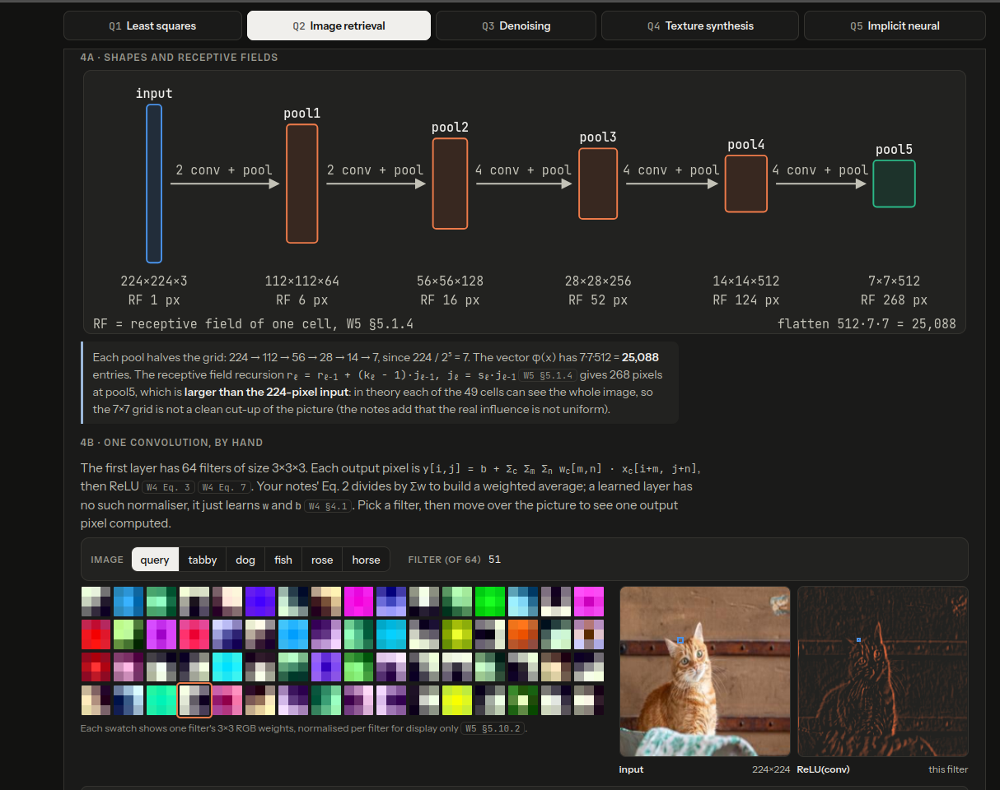

# MLVC-CW

Interactive, in-browser walkthroughs of the five MLVC coursework questions. Each page explains its question with live plots and controls you can play with.

## Pages

| | Page | What it covers |
|---|---|---|
| Q1 | [Least squares](Least%20Squares%20Q1.html) | Fitting a model by minimising squared error |
| Q2 | [Image retrieval](Image%20Retrieval%20Q2(1).html) | Turning images into feature vectors and comparing them |
| Q3 | [Denoising](Denoising%20Q3.html) | A hand-written Gaussian filter versus a learned CNN |
| Q4 | [Texture synthesis](Texture%20Synthesis%20Q4.html) | Q2 run backwards: generating an image from feature statistics |
| Q5 | [Implicit neural representations](Implicit%20Neural%20Q5(1).html) | An image as a function from coordinates to colour |

## How to use

Open `index.html` in a browser. It goes straight to Q1.

- The buttons across the top jump to any question.
- At the bottom of each page, use **← previous** and **next →** to move through them in order.
- The left and right arrow keys also move between questions.

The navigation lives in `nav.js`, so keep it in the same folder as the pages.
